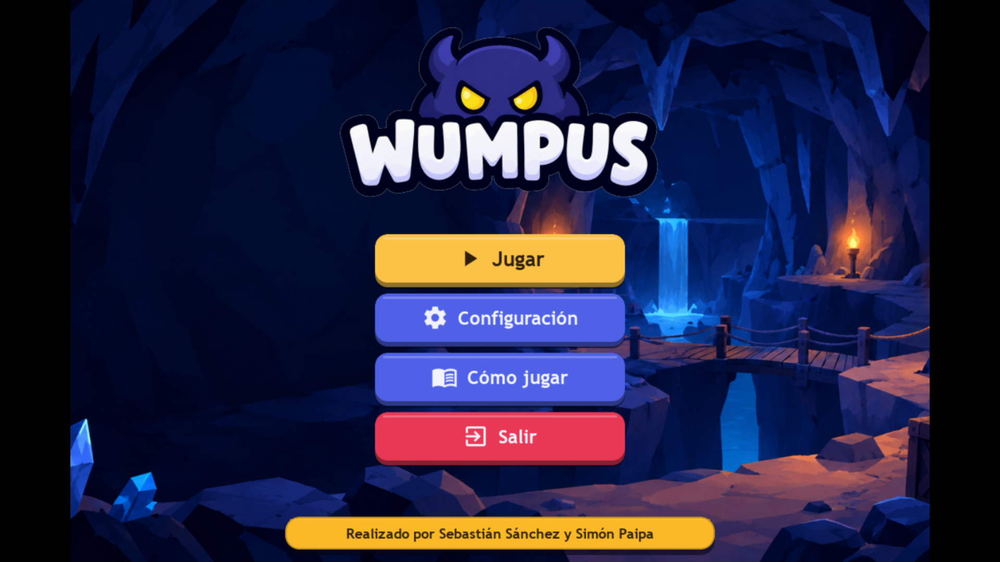

# Wumpus World

<p align="center"></p>

Una aventura gráfica y un ejercicio de inteligencia artificial inspirado en el mundo de Wumpus. Pedro explora una cueva, interpreta señales del entorno y debe recoger el oro para regresar a la entrada con vida.

## Cómo se juega

Las casillas cercanas a peligros dejan pistas: la brisa advierte de un pozo, el hedor de Wumpus y el brillo señala el oro. Pedro recuerda lo que ha visitado y usa esas percepciones para decidir por dónde avanzar. Puede recoger el oro, disparar una flecha y volver a la salida; cada acción afecta la puntuación.

La puntuación premia el oro y penaliza acciones, disparos y muerte. Los tableros se cargan desde `data/`; las reglas, el agente y el estado de partida están en `logic/`, y la experiencia gráfica está en `interface/`.

## Abrir el juego

En Windows, descarga y ejecuta el juego portable. No requiere instalar Python.

<p align="center"><a href="https://github.com/sebasjq/wumpus-world/releases/latest/download/WumpusWorld.exe"><strong>⬇ Descargar Wumpus World para Windows</strong></a></p>

Para ejecutar desde el código se requiere Python 3.12 y Pygame-CE:

```bash
python -m pip install -r requirements.txt
python main.py
```

## Equipo

- Simón Tomás Paipa Bravo
- Juan Sebastián Sánchez Quimbaya
