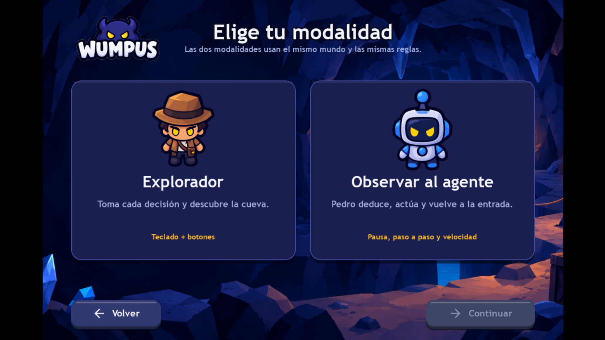
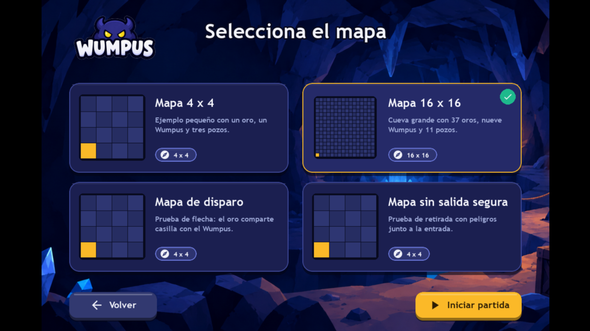
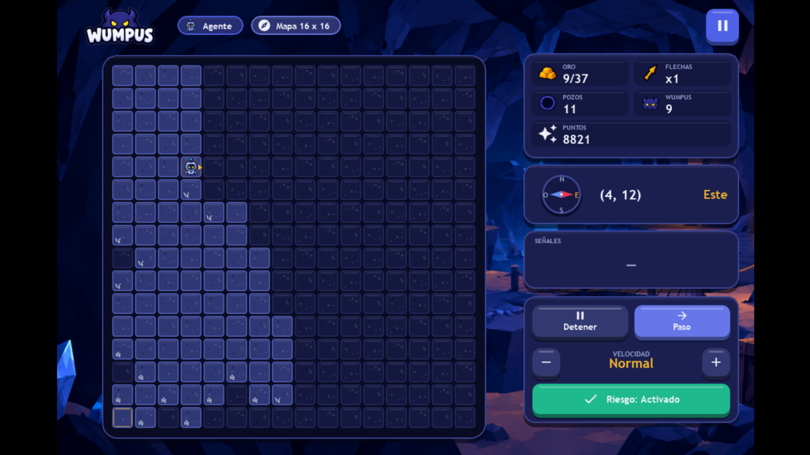
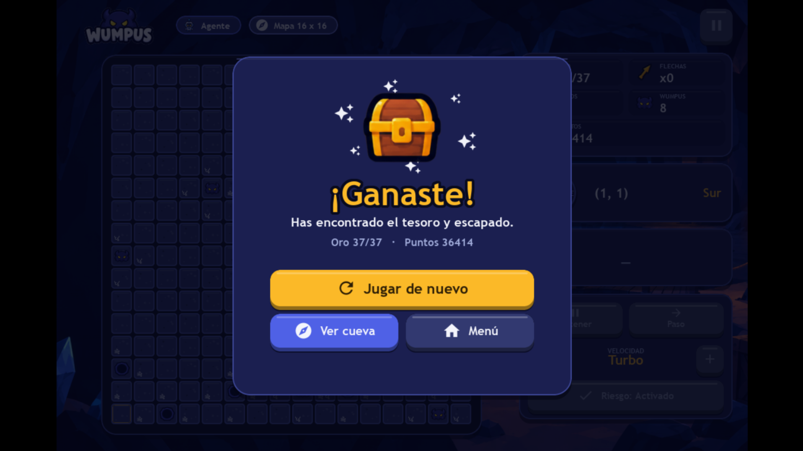
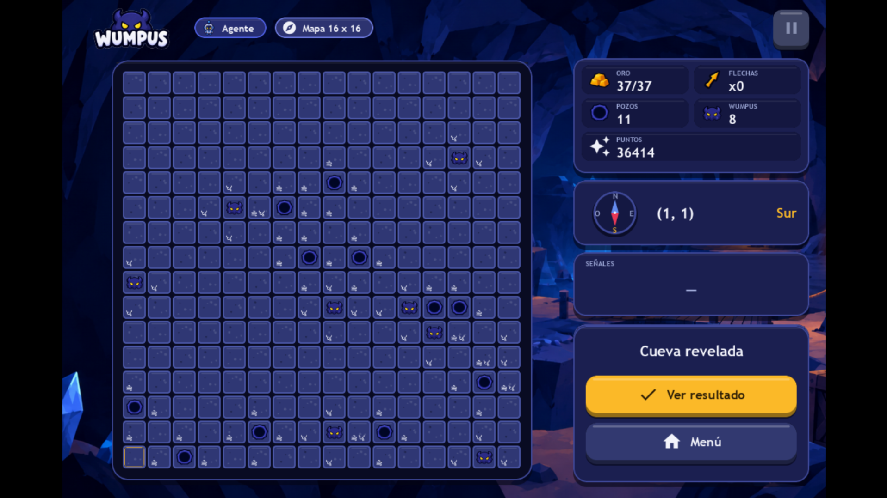

# Wumpus World

Una aventura gráfica y un ejercicio de inteligencia artificial inspirado en el mundo de Wumpus. Pedro explora una cueva, interpreta señales del entorno y debe recoger el oro para regresar a la entrada con vida.

## Cómo se juega

Las casillas cercanas a peligros dejan pistas: la brisa advierte de un pozo, el hedor de Wumpus y el brillo señala el oro. Pedro recuerda lo que ha visitado y usa esas percepciones para decidir por dónde avanzar. Puede recoger el oro, disparar una flecha y volver a la salida; cada acción afecta la puntuación.

La puntuación premia el oro y penaliza acciones, disparos y muerte. Los tableros se cargan desde `data/`; las reglas, el agente y el estado de partida están en `logic/`, y la experiencia gráfica está en `interface/`.

## La experiencia

Puedes jugar como **Explorador**, tomando cada decisión con el teclado y los botones, o elegir **Observar al agente** para seguir las decisiones de Pedro. Ambas modalidades comparten el mundo y sus reglas. El agente permite pausar, avanzar paso a paso y ajustar la velocidad.

  
  

<em>Dos modalidades y escenarios para explorar, disparar o practicar la retirada.</em>

Los mapas incluyen una cueva pequeña de 4 × 4, una de 16 × 16 y escenarios específicos de disparo y salida insegura. Durante la exploración, el tablero conserva las casillas descubiertas y el panel muestra oro, flechas, puntuación, orientación y señales percibidas.

<em>Exploración del agente: el conocimiento del mapa crece con cada paso.</em>

Al terminar, puedes consultar el resultado y revelar la cueva para comparar lo explorado con la ubicación de los peligros. Estas capturas muestran una partida que terminó con los 37 oros y el regreso a la entrada.

  
  

<em>Resultado de la partida y revisión del mapa completo.</em>

## Primeros pasos

1. Abre **Cómo jugar** para conocer las señales, los peligros y las acciones.
2. Pulsa **Jugar**, elige una modalidad y selecciona un mapa. El de 4 × 4 permite familiarizarse con las reglas.
3. En modo agente, utiliza la pausa y el avance por pasos para observar sus decisiones.
4. Consulta el resultado y la cueva al finalizar. En **Configuración** puedes ajustar la velocidad y la visualización de percepciones y coordenadas.

## Abrir el juego

En Windows, descarga y ejecuta el juego portable. No requiere instalar Python.

<a href="https://github.com/sebasjq/wumpus-world/releases/latest/download/WumpusWorld.exe"><strong>⬇ Descargar Wumpus World para Windows</strong></a>

## Equipo

- Simón Tomás Paipa Bravo
- Juan Sebastián Sánchez Quimbaya
